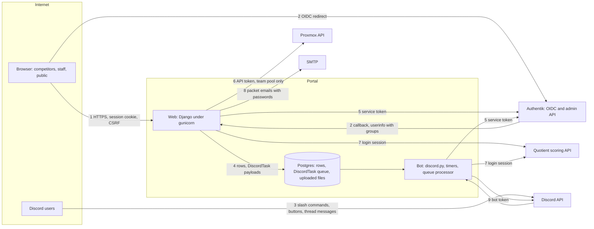

# Threat model

What the portal defends, against whom, and the rules a change must keep. Every mitigation cites the code or the test
that enforces it, by file and, where one applies, by name (`web/core/tests/test_threat_model_citations.py` fails when
a cited file or name no longer exists); a change that moves a trust boundary updates this file in the same pull request.

## Attackers and their goals

| Attacker | Starts with | Wants |
|---|---|---|
| Blue team competitor | The team's shared Authentik account, a linked Discord account | Another team's tickets, reports, scores or credentials; staff powers (scoring, resets, broadcasts); to slow or break a rival's boxes |
| Anonymous visitor | The public site | The registration form as a spam or script injection channel; any page or file without signing in |
| Discord server member | A Discord account in the server, unlinked or linked | Staff bot commands; a link to someone else's portal account; mass pings through the bot |
| Staff member over reach | One staff role (red, orange, white, ticketing) | Another role's powers: changing scores, reading team credentials, resetting accounts |
| Hostile upstream answer | A malformed or spoofed Authentik, Quotient or Proxmox response | A crash, a wrong grant, or a write made from bad data |

Competitors are adversarial and score points for disruption, so every blue team member is assumed to probe the portal
during an event.

## Assets ranked by impact

1. **Authentik service token** (`web/portal/settings.py` `AUTHENTIK_TOKEN`): sets any team's password, ends sessions,
   toggles app bindings and group membership.
2. **Proxmox API token** (`web/portal/settings.py` `PROXMOX_API_TOKEN`): rolls back and starts team VMs.
3. **Discord bot token**: posts as the bot, manages roles and channels in the event server.
4. **Team account passwords**: in Authentik, mirrored in `SchoolInfo.password` for packet emails
   (`web/core/authentik_utils.py` `_new_password`), in the bulk reset CSV and in packet emails.
5. **Scoring integrity**: point adjustments, inject grades, incident and red team scores that decide placings.
6. **`SECRET_KEY` and sessions**: sign sessions, CSRF tokens and OAuth state.
7. **Registrant contact details**: school contact names and email addresses.
8. **Availability during an event**: ticketing, box resets and scoring must keep working for every team.
9. **The start message**: the default VM credentials posted to every team at the start, in
   `CompetitionConfig.start_message`, in queued copies (`QueuedAnnouncement`) and in the payload of each broadcast a
   start queues, whose task id the start records in `CompetitionConfig.start_broadcasts`
   (`web/core/services/competition.py` `run_competition`). Its audit row stores only its length (`set_start_message`).
   When the event is closed out or cancelled, or the bot's cleanup resets for the next event, the message and every
   queued announcement are cleared and each recorded broadcast is scrubbed and, if not finished, failed: a pending one
   is never sent, one being sent stops before the next team once the reset commits, and neither is retried, by the queue or by the
   admin's Retry failed tasks (`web/registration/services.py` `_reset_for_next_event`; `bot/discord_queue.py`
   `DiscordQueueProcessor._record`, `DiscordQueueProcessor._still_processing`; `web/core/admin.py`
   `DiscordTaskAdmin.retry_failed_tasks`). For broadcasts queued before starts recorded them,
   `web/core/migrations/0021_scrub_start_broadcasts.py` scrubs the finished ones and hands unfinished ones to the next reset.

## Trust boundaries and data flows

## Threats per boundary (STRIDE) and their mitigations

| # | Boundary | Threat | Mitigation |
|---|---|---|---|
| 1 | Browser to web | E: a role reaches a page or action it lacks | Every view carries `require_permission` (`web/core/auth_utils.py` `require_permission`) or checks itself; the views harness drives every URL as every role and fails on a wrong answer (`web/core/tests/views_harness.py`), and `web/core/tests/test_property_coverage.py` fails on a URL without a row |
| 1 | Browser to web | I: a team reads another team's ticket, report or attachment | `team_record_or_404` filters to the caller's team, so another team's record is a 404 like a missing one (`web/core/auth_utils.py` `team_record_or_404`) |
| 1 | Browser to web | T: a team member files a ticket as another team | The create ticket form ignores a posted team unless the view passes the teams to pick from, which it does only for gold team, admins and ticketing admins (`web/ticketing/forms.py` `CreateTicketForm`, `web/ticketing/views/create.py` `create_ticket`, `web/ticketing/tests/test_create_ticket_as_ticketing_admin.py`) |
| 1 | Browser to web | T: cross-site request forgery | `CsrfViewMiddleware` on, no `csrf_exempt` view (`web/core/tests/test_csrf_coverage.py`); views read POST fields through Django forms (`web/core/tests/test_no_raw_post.py`) |
| 1 | Browser to web | T, E: script injection through stored or reflected text | Templates and cotton attributes escape every value (`web/core/cotton.py`, `web/core/tests/test_cotton_escaping.py`, `web/core/tests/test_list_filter_escaping.py`, `web/core/tests/test_ticket_detail_escaping.py`); scripts are vendored (`web/core/tests/test_no_third_party_scripts.py`); `frame-ancestors 'none'` (`web/core/middleware.py` `SecurityHeadersMiddleware`) |
| 1 | Browser to web | T, E: script injection through a form's label, help text or error | Every field renders through the portal's row template, which escapes its label, help text and errors (Django's own marks help text safe) (`web/core/form_renderer.py` `PortalFormRenderer`, `web/core/tests/test_form_rows.py`); a forms module calls the markup functions (`format_html` or `mark_safe`) directly and with literals only, since escaping a value can't stop a `javascript:` link (`web/registration/forms.py` `RegistrationForm`, `web/core/tests/test_form_conventions.py`) |
| 1 | Browser to web | T: an uploaded file runs as a page | Files are typed from their bytes; only images and PDFs show inline and everything else downloads; every file answer but an inline PDF carries a sandbox CSP (`web/core/stored_files.py` `file_response`) |
| 1 | Browser to web | S: open redirect after sign-in | `next` is checked against the host at login and callback (`web/core/oauth.py` `oauth_login`, `oauth_callback`) |
| 1 | Browser to web | D: registration flood | 10 successful submissions per hour per client, an IPv4 address or an IPv6 /64, and 50 per IPv6 /48; the check and the count run under an advisory lock on the client's network (`web/registration/models.py` `RegistrationRateLimit.TIERS`, `RegistrationRateLimit.WINDOW`, `RegistrationRateLimit.held`) |
| 1 | Browser to web | S: a spoofed client address dodges the limit | `CF-Connecting-IP` counts only with `TRUST_CF_CONNECTING_IP=true`, else the connecting address does (`web/core/utils.py` `client_ip`; `web/portal/settings.py` `TRUST_CF_CONNECTING_IP`) |
| 1 | Browser to web | I: the public health check reveals the database | It answers only healthy or unhealthy and logs the error server-side (`web/core/views.py` `health_check`) |
| 1 | Browser to web | T: a refusal that still changes something | A refused or 4xx request writes no row, sends no mail and calls no service (the views harness rules, `web/core/tests/views_harness.py`) |
| 2 | OIDC | S: login CSRF or state replay | State is signed with a 300 s lifetime and its nonce is compared in constant time against the session (`web/core/oauth.py` `oauth_callback`) |
| 2 | OIDC | E: stale groups after a role is removed | The bot refreshes groups from Authentik every 5 minutes (`bot/cogs/authentik_groups.py` `AuthentikGroupsCog`), and a refresh aborts on an implausible answer rather than stripping everyone (`web/core/services/user_groups.py` `refresh_user_groups`) |
| 2 | OIDC | S: a reused username inherits an old account | Portal identity is the Authentik `sub`, never the username (`web/core/oauth.py` `oauth_callback`) |
| 3 | Discord to bot | E: a member runs a staff command or button | Bot permissions come from the same stored groups as the web (`bot/permissions.py`), and every command, component and listener has a role row (`bot/tests/test_properties_bot.py`) |
| 3 | Discord to bot | T: a team member files a ticket as another team | A team member's ticket is for their linked team; only ticketing admins name a team (`bot/cogs/ticketing.py` `TicketingCog.create_ticket`, `bot/cogs/help_panels.py` `create_ticket`, `bot/cogs/admin_tickets.py` `AdminTicketsCog.admin_ticket_create`) |
| 3 | Discord to bot | S: linking someone else's portal account | Link tokens are single use, expire in 15 minutes, are bound to the browser session, and complete only after a confirming POST (`web/core/services/linking.py` `lookup_valid_link_token`, `validate_link_token`; `bot/cogs/linking.py` `TOKEN_EXPIRY_MINUTES`; `web/core/views.py` `link_callback`) |
| 3 | Discord to bot | D: mass pings through relayed text | Mentions are off by default (`bot/utils.py` `ALLOWED_MENTIONS`) |
| 4 | Web to bot queue | E: a payload makes the bot act beyond the role that queued it | Tasks are enqueued by gated views and services, and by the link flow only after its token and session checks; each payload is a typed dataclass dispatched by an exhaustive match (`web/core/discord_tasks.py`, `bot/discord_queue.py`) |
| 4 | Web to bot queue | T: a stale task acts on a newer event | A queued team teardown runs only while its event is still the open one and the competition is stopped (`web/registration/services.py` `teardown_problem`); a team handed to a new school with a Discord role or category left on it is marked `channels_need_clearing` in the hand-over's transaction, its removal queued unless one is already pending. A hand-over is an import, Add schools or registration assignment giving the team a school other than the one it held, unless members are still linked to it, and it also deletes the team's queued announcements. On School Info, a changed name is a rename, which keeps the team's school row, or moves it onto the record that already has that name; refused when another team holds it. Or it is a different school, which takes the school list lock, unlinks the team's members under the team row's lock, auditing each, marks it, and once that commits resets the team's Authentik password and ends its Authentik sessions, so the old school can't sign in to Authentik again when it succeeds; a failure is reported and names the team page's Reset Team. A team given its first school there with members still linked is unlinked and reset the same way. Any School Info edit from a stale page is refused, and Remove, Unassign and Clear are refused while members are linked, Remove and Unassign checked under the team row's lock. While the mark is set no setup reuses the role or category, no member is granted the role and broadcasts are queued rather than posted there; the mark is set when the role or category is left (a child channel whose delete fails is only logged) and unset by a delete that leaves nothing; the clear task then queues the setup if members are linked; a team failing a teardown is marked too. A removal that fails for good tells ops to delete the leftovers and run /teams recreate, whose own delete unsets the mark (`web/registration/services.py` `_clear_old_channels`, `unlink_teams`; `web/core/views.py` `school_info_edit`, `_report_new_school`, `school_info_remove`; `web/registration/services.py` `remove_team_school`, `clear_school_list`; `bot/discord_manager.py` `delete_team_infrastructure`, `DiscordManager.setup_team_infrastructure`; `bot/role_sync.py` `role_grants`; `bot/utils.py` `team_chat_channel`) |
| 5 | Portal to Authentik | E: a reset or toggle reaches a non-team account | Only `team{NN}` with 1 to `MAX_TEAMS` is reset or enabled, found by exact username (`web/core/authentik_utils.py` `_team_user`; `web/core/authentik_manager.py` `AuthentikManager.find_user`) |
| 5 | Portal to Authentik | E, I: an ignored list filter acts on the wrong rows | Every list result is checked per row: sessions must belong to the target user, names must match exactly, a binding's target must be the app (`web/core/authentik_manager.py` `AuthentikManager.user_sessions`, `AuthentikManager.find_user`, `AuthentikManager.get_group_by_name`, `AuthentikManager.get_blueteam_binding`) |
| 5 | Portal to Authentik | I: Authentik's URL or answer reaches a page | Operators see `reason_for(e)`, the message alone (`web/core/authentik_manager.py` `reason_for`) |
| 5 | Portal to Authentik | T: a malformed answer read as data | Answers must be 2xx JSON of the expected shape (`web/core/authentik_manager.py` `AuthentikManager._check`, `AuthentikManager._json`, `AuthentikManager._results`, `_holds`); property tests cover every reader (`web/core/tests/test_properties_readers.py`) |
| 6 | Portal to Proxmox | E: a ticket resets another team's VM | VMs are looked up only in the team's pool, VMID range and name prefix (`web/core/proxmox.py` `team_pool_id`, `classify_team_vm`, `ProxmoxClient.list_team_vms`); only ticket staff act (`web/ticketing/views/actions.py` `ticket_box_reset`) |
| 6 | Portal to Proxmox | T: two submissions reset one VM twice | A Postgres advisory lock per ticket admits one reset across workers and pods (`web/ticketing/views/actions.py` `_stream_box_reset`) |
| 7 | Portal to Quotient | T: a bad answer corrupts scores | Typed field validators reject the wrong shape or range (`web/quotient/client.py` `_text`, `_whole`, `_boolean`, `_fraction`) |
| 8 | Portal to SMTP | I: a password mailed to the wrong address | Packets go to the school's contact addresses on its `SchoolInfo` (`web/team/models.py` `SchoolInfo.emails`), or to an address gold team enters for a test send; only gold team sends them, and Django admin's send actions only Discord admins reach (`web/packets/views.py` `packet_action`, `packet_resend_team`; `web/packets/admin.py` `PacketAdmin.distribute_now`, `PacketDistributionAdmin.retry_failed_emails`; `web/core/admin.py` `AuthentikAdminSite.has_permission`) |
| all | Logs and errors | I: tokens or OAuth codes in logs | The access log drops query strings and referers (`web/gunicorn.conf.py` `access_log_format`); httpx URL logging is off (`web/core/tests/test_httpx_logging.py`); error answers come from `web/core/errors.py`: a fixed message for 404, 405 and 500, and only the view's own stated reason for 400 and 403 |
| all | Logs and errors | T: request text forges a log line or an alert | Request text is escaped where the app logs it (`web/core/middleware.py` `_field`; `web/core/log_safety.py`), the console formatter keeps every message on one line, gunicorn escapes its access and error lines (`web/gunicorn.conf.py` `EscapingLogger`), and the Discord alert shows request text in code spans (`web/core/discord_logging.py` `_code`); property tests cover each line (`web/core/tests/test_properties_log_lines.py`) |
| all | Secrets | S: forged sessions | The web refuses to start without a real `SECRET_KEY` (`web/portal/wsgi.py`); the session cookie is HttpOnly and SameSite=Lax, and outside `DEBUG` the session and CSRF cookies are Secure with HSTS (`web/portal/settings.py` `SESSION_COOKIE_HTTPONLY`, `SESSION_COOKIE_SAMESITE`, `SESSION_COOKIE_SECURE`, `CSRF_COOKIE_SECURE`, `SECURE_HSTS_SECONDS`) |
| all | Repudiation | R: a staff action nobody can trace | Credential resets, competition start and stop, schedule edits (`/competition clear-start-time` among them), controlled-app, max-members and start-message edits, the setup page's Quotient metadata sync and group membership fix, the cleanup reset write `AuditLog` rows naming the actor, and a teardown that runs records its own, except an opening's teardown that changed nothing and failed nowhere; resets from the team page, bulk reset and the bot post to the ops channel; a packet send records its password set as `team_password_set` (`web/core/models.py` `AuditLog`; `web/core/authentik_utils.py` `reset_team_credentials`, `reset_teams_credentials`, `set_team_password`; `web/core/services/competition.py` `run_competition`, `set_schedule`, `set_controlled_apps`, `set_max_members`, `set_start_message`; `web/core/admin_views/readiness.py` `sync_quotient`, `fix_group_membership`; `web/registration/services.py` `reset_for_discord_cleanup`; `bot/competition_actions.py` `reconcile_teams`; `web/core/discord_tasks.py` `LogToChannel`; `bot/utils.py` `log_to_ops_channel`) |

## Accepted risks and non-goals

- **Shared team accounts.** Members of a team share one Authentik account, so the portal cannot tell them apart and any
  member acts for the whole team (`web/team/models.py` `team_username`).
- **Authentik is the authority.** Its administrators and the portal's service account are trusted; group membership
  there is the only source of roles. The service token's own permissions bound what the portal can do.
- **Gold team holds near-admin power by design**: credential resets, app and account toggles, broadcasts and packet
  passwords. Only `WCComps_Discord_Admin` reaches Django admin.
- **Upstream truth.** Quotient's scores and Proxmox's VM state are validated for shape, not for honesty.
- **Cloudflare's client address is trusted only when configured.** A deployment behind Cloudflare sets
  `TRUST_CF_CONNECTING_IP=true`; the self-hosting `docker-compose.yml` leaves it off, so its limits key on the
  connecting address.
- **Inline scripts are allowed by the CSP**, so script injection defence rests on escaping, which the escaping tests
  guard.
- **Team passwords are deliberately readable by admins and gold team**: packet emails need them in clear text.
- **Roles change within the 5-minute refresh**, not instantly; sessions last 12 hours from the last request.
- **Out of scope:** the hosting cluster, Authentik's own security, Discord's platform, and denial of service at
  network scale.

## Build and deploy path

1. A change lands on `main` through a pull request whose CI passes: ruff format and lint, djlint, mypy, the migrations
   check and the test suite (`.github/workflows/tests.yml`).
2. Dependencies come from `uv.lock`, installed `--frozen` (`Dockerfile`); updates arrive only as Dependabot pull
   requests (`.github/dependabot.yml`).
3. CI on `main` builds one image for web and bot and pushes it to GHCR as `sha-<commit>` (`.github/workflows/ci.yml`).
   Third-party actions are pinned to commit SHAs and base images to digests (`web/core/tests/test_python_pin.py`), and
   the image runs as uid 1001, not root (`Dockerfile`). Each web container migrates under a Postgres advisory lock, so
   replicas take turns (`web/core/management/commands/prepare_database.py` `Command.handle`).
4. A separate private GitOps repository pins that tag; production changes only when a person merges the tag bump there.
   Production secrets live there, never in this repository.

## Owner and review trigger

The repository maintainers own this file. Update it in the same pull request when a change:

- adds or changes an entry point: a URL, a bot command, component or listener, a DiscordTask payload, an inbound
  callback;
- adds a role, changes `PERMISSION_MAP`, or changes who may reach a service-token action;
- adds an outside service, credential or secret, or changes where one is stored, logged or shown;
- changes how files, uploads or user text are stored or rendered;
- changes the build, the dependency policy or the deploy path.

Review it in full before each event, alongside the readiness checks.
