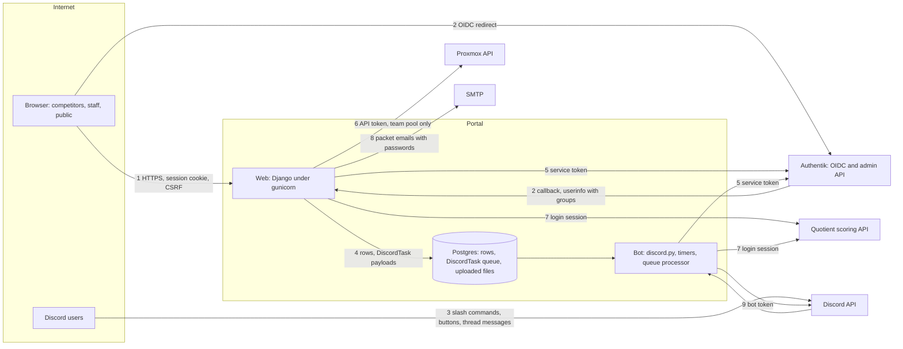

# Threat model

What the portal defends, against whom, and the rules a change must keep. Every mitigation cites the code or the test
that enforces it; a change that moves a trust boundary updates this file in the same pull request.

## Attackers and their goals

| Attacker | Starts with | Wants |
|---|---|---|
| Blue team competitor | The team's shared Authentik account, a linked Discord account | Another team's tickets, reports, scores or credentials; staff powers (scoring, resets, broadcasts); to slow or break a rival's boxes |
| Anonymous visitor | The public site | The registration form as a spam or script injection channel; any page or file without signing in |
| Discord server member | A Discord account in the server, unlinked or linked | Staff bot commands; a link to someone else's portal account; mass pings through the bot |
| Staff member over reach | One staff role (red, orange, white, ticketing) | Another role's powers: changing scores, reading team credentials, resetting accounts |
| Hostile upstream answer | A malformed or spoofed Authentik, Quotient or Proxmox response | A crash, a wrong grant, or a write made from bad data |

Competitors are adversarial and score points for disruption, so every blue team member is assumed to probe the portal
during an event.

## Assets ranked by impact

1. **Authentik service token** (`AUTHENTIK_TOKEN`, `web/portal/settings.py:215`): sets any team's password, ends sessions,
   toggles app bindings and group membership.
2. **Proxmox API token** (`web/portal/settings.py:224`): rolls back and starts team VMs.
3. **Discord bot token**: posts as the bot, manages roles and channels in the event server.
4. **Team account passwords**: in Authentik, mirrored in `SchoolInfo.password` for packet emails
   (`web/core/authentik_utils.py:95`), in the bulk reset CSV and in packet emails.
5. **Scoring integrity**: point adjustments, inject grades, incident and red team scores that decide placings.
6. **`SECRET_KEY` and sessions**: sign sessions, CSRF tokens and OAuth state.
7. **Registrant contact details**: school contact names and email addresses.
8. **Availability during an event**: ticketing, box resets and scoring must keep working for every team.

## Trust boundaries and data flows

## Threats per boundary (STRIDE) and their mitigations

| # | Boundary | Threat | Mitigation |
|---|---|---|---|
| 1 | Browser to web | E: a role reaches a page or action it lacks | Every view carries `require_permission` (`web/core/auth_utils.py:81`) or checks itself; the views harness drives every URL as every role and fails on a wrong answer (`web/core/tests/views_harness.py:1`), and `test_property_coverage` fails on a URL without a row |
| 1 | Browser to web | I: a team reads another team's ticket, report or attachment | `team_record_or_404` filters to the caller's team, so another team's record is a 404 like a missing one (`web/core/auth_utils.py:105`) |
| 1 | Browser to web | T: cross-site request forgery | `CsrfViewMiddleware` on, no `csrf_exempt` view (`web/core/tests/test_csrf_coverage.py`); views read POST fields through Django forms (`web/core/tests/test_no_raw_post.py`) |
| 1 | Browser to web | T, E: script injection through stored or reflected text | Templates and cotton attributes escape every value (`web/core/cotton.py`, `test_cotton_escaping.py`, `test_list_filter_escaping.py`, `test_ticket_detail_escaping.py`); scripts are vendored (`test_no_third_party_scripts.py`); `frame-ancestors 'none'` (`web/core/middleware.py:35`) |
| 1 | Browser to web | T: an uploaded file runs as a page | Files are typed from their bytes; only images and PDFs show inline and everything else downloads; every file answer but an inline PDF carries a sandbox CSP (`web/core/stored_files.py:60`) |
| 1 | Browser to web | S: open redirect after sign-in | `next` is checked against the host at login and callback (`web/core/oauth.py:61`) |
| 1 | Browser to web | D: registration flood | 10 successful submissions per hour per client IP (`web/registration/views.py:44`) |
| 1 | Browser to web | T: a refusal that still changes something | A refused or 4xx request writes no row, sends no mail and calls no service (views harness rules, `views_harness.py:5`) |
| 2 | OIDC | S: login CSRF or state replay | State is signed with a 300 s lifetime and its nonce is compared in constant time against the session (`web/core/oauth.py:172`, `:189`) |
| 2 | OIDC | E: stale groups after a role is removed | The bot refreshes groups from Authentik every 5 minutes (`bot/cogs/authentik_groups.py:49`), and a refresh aborts on an implausible answer rather than stripping everyone (`web/core/services/user_groups.py:61`) |
| 2 | OIDC | S: a reused username inherits an old account | Portal identity is the Authentik `sub`, never the username (`web/core/oauth.py:264`) |
| 3 | Discord to bot | E: a member runs a staff command or button | Bot permissions come from the same stored groups as the web (`bot/permissions.py`), and every command, component and listener has a role row (`bot/tests/test_properties_bot.py`) |
| 3 | Discord to bot | S: linking someone else's portal account | Link tokens are single use, expire in 15 minutes, are bound to the browser session, and complete only after a confirming POST (`web/core/services/linking.py:55`, `web/core/views.py:136`) |
| 3 | Discord to bot | D: mass pings through relayed text | Mentions are off by default (`bot/utils.py:29`) |
| 4 | Web to bot queue | E: a payload makes the bot act beyond the role that queued it | Tasks are enqueued by gated views and services, and by the link flow only after its token and session checks; each payload is a typed dataclass dispatched by an exhaustive match (`web/core/discord_tasks.py`, `bot/discord_queue.py`) |
| 5 | Portal to Authentik | E: a reset or toggle reaches a non-team account | Only `team{NN}` with 1 to `MAX_TEAMS` is reset or enabled, found by exact username (`web/core/authentik_utils.py:18`, `web/core/authentik_manager.py:361`) |
| 5 | Portal to Authentik | E, I: an ignored list filter acts on the wrong rows | Every list result is checked per row: sessions must belong to the target user, names must match exactly, a binding's target must be the app (`web/core/authentik_manager.py:320`, `:241`) |
| 5 | Portal to Authentik | I: Authentik's URL or answer reaches a page | Operators see `reason_for(e)`, the message alone (`web/core/authentik_manager.py:60`) |
| 5 | Portal to Authentik | T: a malformed answer read as data | Answers must be 2xx JSON of the expected shape (`_check`, `_json`, `_results`, `_holds`); property tests cover every reader (`web/core/tests/test_properties_readers.py`) |
| 6 | Portal to Proxmox | E: a ticket resets another team's VM | VMs are looked up only in the team's pool, VMID range and name prefix (`web/core/proxmox.py:56`, `:226`); only ticket staff act (`web/ticketing/views/actions.py:422`) |
| 7 | Portal to Quotient | T: a bad answer corrupts scores | Typed field validators reject the wrong shape or range (`web/quotient/client.py:58`) |
| 8 | Portal to SMTP | I: a password mailed to the wrong address | Packets go to the school's contact addresses on its `SchoolInfo` (`web/team/models.py:261`), or to an address gold team enters for a test send; only gold team sends them |
| all | Logs and errors | I: tokens or OAuth codes in logs | The access log drops query strings and referers (`web/gunicorn.conf.py:19`); httpx URL logging is off (`test_httpx_logging.py`); error answers come from `web/core/errors.py`: a fixed message for 404, 405 and 500, and only the view's own stated reason for 400 and 403 |
| all | Secrets | S: forged sessions | The web refuses to start without a real `SECRET_KEY` (`web/portal/wsgi.py:9`); the session cookie is HttpOnly and SameSite=Lax, and outside `DEBUG` the session and CSRF cookies are Secure with HSTS (`web/portal/settings.py:157`, `:182`) |
| all | Repudiation | R: a staff action nobody can trace | Credential resets, competition start and stop, and app edits write `AuditLog` rows naming the actor, and resets from the team page, bulk reset and the bot post to the ops channel; a packet send records its password set as `team_password_set` |

## Accepted risks and non-goals

- **Shared team accounts.** Members of a team share one Authentik account, so the portal cannot tell them apart and any
  member acts for the whole team (`web/team/models.py:16`).
- **Authentik is the authority.** Its administrators and the portal's service account are trusted; group membership
  there is the only source of roles. The service token's own permissions bound what the portal can do.
- **Gold team holds near-admin power by design**: credential resets, app and account toggles, broadcasts and packet
  passwords. Only `WCComps_Discord_Admin` reaches Django admin.
- **Upstream truth.** Quotient's scores and Proxmox's VM state are validated for shape, not for honesty.
- **Cloudflare fronts every request**, so the registration limit trusts `CF-Connecting-IP` (`web/core/utils.py:27`);
  a deployment without it must not expose the portal directly. The self-hosting `docker-compose.yml` publishes the web
  port, so it needs a proxy in front that sets that header itself.
- **Inline scripts are allowed by the CSP**, so script injection defence rests on escaping, which the escaping tests
  guard.
- **Team passwords are deliberately readable by admins and gold team**: packet emails need them in clear text.
- **Roles change within the 5-minute refresh**, not instantly; sessions last 12 hours from the last request.
- **Out of scope:** the hosting cluster, Authentik's own security, Discord's platform, and denial of service at
  network scale.

## Build and deploy path

1. A change lands on `main` through a pull request whose CI passes: ruff format and lint, mypy, the migrations check
   and the test suite (`.github/workflows/tests.yml`).
2. Dependencies come from `uv.lock`, installed `--frozen` (`Dockerfile`); updates arrive only as Dependabot pull
   requests (`.github/dependabot.yml`).
3. CI on `main` builds one image for web and bot and pushes it to GHCR as `sha-<commit>` (`.github/workflows/ci.yml`).
   Workflow actions and base images are pinned by version tag.
4. A separate private GitOps repository pins that tag; production changes only when a person merges the tag bump there.
   Production secrets live there, never in this repository.

## Owner and review trigger

The repository maintainers own this file. Update it in the same pull request when a change:

- adds or changes an entry point: a URL, a bot command, component or listener, a DiscordTask payload, an inbound
  callback;
- adds a role, changes `PERMISSION_MAP`, or changes who may reach a service-token action;
- adds an outside service, credential or secret, or changes where one is stored, logged or shown;
- changes how files, uploads or user text are stored or rendered;
- changes the build, the dependency policy or the deploy path.

Review it in full before each event, alongside the readiness checks.
