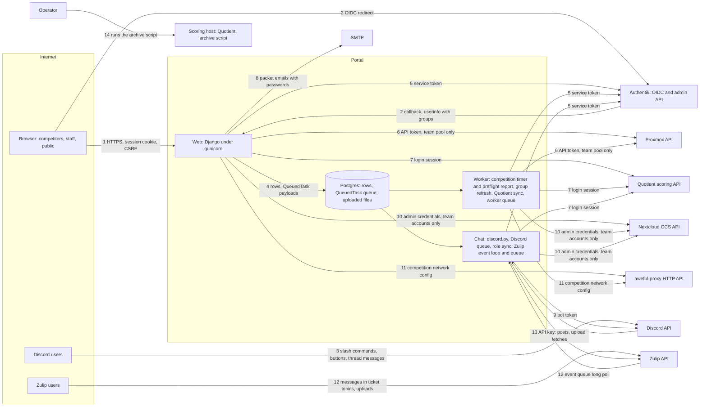

# Threat model

What the portal defends, against whom, and the rules a change must keep. Every mitigation cites the code or the test
that enforces it, by file and, where one applies, by name (`web/core/tests/test_threat_model_citations.py` fails when
a cited file or name no longer exists); a change that moves a trust boundary updates this file in the same pull request.

## Attackers and their goals

| Attacker | Starts with | Wants |
|---|---|---|
| Blue team competitor | The team's shared Authentik account, a linked Discord account | Another team's tickets, reports, scores or credentials; staff powers (scoring, resets, broadcasts); to slow or break a rival's boxes |
| Anonymous visitor | The public site | The registration form as a spam or script injection channel; any page or file without signing in |
| Discord server member | A Discord account in the server, unlinked or linked | Staff bot commands; a link to someone else's portal account; mass pings through the bot |
| Zulip realm member | A Zulip account in the realm, whose email and display name Zulip reports and the portal doesn't verify | To write to a ticket that isn't theirs, or as someone else; mass pings through the bot; files from streams they can't read |
| Staff member over reach | One staff role (red, orange, white, ticketing) | Another role's powers: changing scores, reading team credentials, resetting accounts |
| Hostile upstream answer | A malformed or spoofed Authentik, Quotient, Proxmox, Nextcloud or Zulip response | A crash, a wrong grant, or a write made from bad data |
| Scoring host user | A local account on the scoring host, or write access to an event's `submissions/` | The archived team uploads and runner addresses; to slip a host file into an archive or replace one. Whoever can write the event's Compose directory itself is as trusted as the operator: they control the Compose file and can point `submissions` at any directory the operator can read |

Competitors are adversarial and score points for disruption, so every blue team member is assumed to probe the portal
during an event.

## Assets ranked by impact

1. **Authentik service token** (`web/portal/settings.py` `AUTHENTIK_TOKEN`): sets any team's password, ends sessions,
   toggles app bindings and group membership.
2. **Proxmox API token and Nextcloud admin credentials** (`web/portal/settings.py` `PROXMOX_API_TOKEN`, `NEXTCLOUD_USERNAME`, `NEXTCLOUD_PASSWORD`): roll back and start team VMs, and provision or delete blue team Nextcloud accounts and files.
3. **Discord bot token**: posts as the bot, manages roles and channels in the event server. The chat process acts with
   it; web and the worker carry `DISCORD_BOT_TOKEN` only so they queue Discord rows (`web/core/task_backends.py`
   `configured_chat_backends`) and show the Discord pages (`discord_enabled`).
4. **Zulip bot API key** (`web/portal/settings.py` `ZULIP_API_KEY`): posts as the bot, reads every stream the bot is
   subscribed to (each team's, staff's, ops') and fetches any upload the bot can see. The chat process acts with it;
   web and the worker carry the `ZULIP_*` settings only so they queue Zulip rows (`web/core/task_backends.py`
   `configured_chat_backends`), and the client refuses a site that isn't https, as every request carries the key
   (`chat/zulip/client.py` `ZulipClient`).
5. **Team account passwords**: in Authentik, mirrored in `SchoolInfo.password` for packet emails
   (`web/core/authentik_utils.py` `_store_password`), in the bulk reset CSV (only to whoever ran the reset) and in
   packet emails.
6. **Scoring integrity**: point adjustments, inject grades, incident and red team scores that decide placings.
7. **`SECRET_KEY` and sessions**: sign sessions, CSRF tokens and OAuth state.
8. **Registrant contact details**: school contact names and email addresses.
9. **Availability during an event**: ticketing, box resets and scoring must keep working for every team.
10. **The start message**: the default VM credentials posted to every team at the start, in
   `CompetitionConfig.start_message`, in queued copies (`QueuedAnnouncement`) and in the payload of each broadcast row a
   start queues (one per chat backend), whose task ids the start records in `CompetitionConfig.start_broadcasts`
   (`web/core/services/competition.py` `run_competition`). Its audit row stores only its length (`set_start_message`), and its broadcast summary omits the message (`bot/competition_actions.py` `BroadcastResult.ops_summary`).
   When the event is closed out or cancelled, or the bot's cleanup resets for the next event, the message and every
   queued announcement are cleared and each recorded broadcast is scrubbed and, if not finished, failed: a pending one
   is never sent, one being sent stops before the next team and queues no further copy for a team without channels
   once the reset commits, and neither is retried, by the queue or by the
   admin's Retry failed tasks (`web/registration/services.py` `_reset_for_next_event`; `web/core/task_queue.py`
   `QueueProcessor._record`, `TaskProgress.still_running`, `TaskProgress.while_running`; `web/core/admin.py`
   `QueuedTaskAdmin.retry_failed_tasks`). For broadcasts queued before starts recorded them,
   `web/core/migrations/0024_scrub_start_broadcasts.py` scrubs the finished ones and hands unfinished ones to the next reset.
11. **Event records kept after Close Out**: the close-out archive (`EventArchive.data`, `web/registration/models.py`),
   written in the Close Out transaction before the wipe and never deleted: every export dataset, with every team's
   ticket comments (their Discord threads and Zulip topics as the portal recorded them), ticket history and
   attachment names, sizes and SHA-256 (not the files) (`web/registration/services.py` `_freeze_results`;
   `web/scoring/export.py` `DATASETS`). Only Gold Team downloads it (`web/registration/views.py` `event_archive`), as
   it does the same datasets live (`web/scoring/views/export.py`). Off the portal, the scoring host's archive script
   writes a tarball of the teams' inject uploads and the divisor log of runner source addresses
   (`web/quotient/archive_scoring_host.py`).
12. **Quotient admin login** (`web/portal/settings.py` `QUOTIENT_USERNAME`, `QUOTIENT_PASSWORD`): reads every team's
   check output, including the credentials each check used, and can pause the engine and reset or change Quotient's
   scores (asset 6). Web holds it for inject grading, ticket check history, the setup page's sync and the score sync,
   the worker for the metadata sync and the preflight report, and the chat process for the stop's score sync (boundary
   7).

## Trust boundaries and data flows

The worker (`worker/__main__.py`) runs the competition timer (which also reads Quotient's admin-only engine status
before a scheduled start, for the preflight report it queues as an ops notice), the group refresh, the Quotient sync
(which reads team VMs from Proxmox and pushes the network config to aweful-proxy) and the worker queue (Nextcloud, and
the Quotient sync a competition start queues: `web/core/worker_tasks.py` `WorkerQueueProcessor._sync_quotient_metadata`),
so it holds the Authentik token, the Quotient login, the Proxmox token, the Nextcloud credentials and the aweful-proxy
token. The chat
process (`chat/__main__.py`) holds the Discord token and the Zulip API key (each when its backend is configured), and
the same Authentik, Nextcloud and Quotient credentials for its `/competition` and reset commands: `/competition start`
runs the competition service, which provisions Nextcloud and queues the Quotient metadata sync to the worker rather
than running it, and `/competition stop` syncs the final scores from Quotient (`web/core/services/competition.py`
`_run`). It holds no Proxmox or aweful-proxy credentials and never reaches either. Its Zulip runner polls an event
queue Zulip fills with the messages in the streams the bot is subscribed to, so it needs no public endpoint
(`chat/zulip/runner.py` `event_loop`; `chat/zulip/client.py` `ZulipClient.register_queue`).

## Threats per boundary (STRIDE) and their mitigations

| # | Boundary | Threat | Mitigation |
|---|---|---|---|
| 1 | Browser to web | E: a role reaches a page or action it lacks | Every view carries `require_permission` (`web/core/auth_utils.py` `require_permission`) or checks itself; the views harness drives every URL as every role and fails on a wrong answer (`web/core/tests/views_harness.py`), and `web/core/tests/test_property_coverage.py` fails on a URL without a row |
| 1 | Browser to web | I: a team reads another team's ticket, report or attachment | `team_record_or_404` filters to the caller's team, so another team's record is a 404 like a missing one (`web/core/auth_utils.py` `team_record_or_404`); the ticket page and the bot's ticket thread and buttons share one rule (`web/ticketing/access.py` `ticket_open_to`) |
| 1 | Browser to web | I: someone outside Gold Team reads every team's ticket threads in the close-out archive or an export | The archive download and every export view carry `require_permission("gold_team")` (`web/registration/views.py` `event_archive`; `web/scoring/views/export.py`); team text in the CSVs goes through `safe_cell` against formula injection (`web/core/csv_export.py`) |
| 1 | Browser to web | T: a team member files a ticket as another team | The create ticket form ignores a posted team unless the view passes the teams to pick from, which it does only for gold team, admins and ticketing admins (`web/ticketing/forms.py` `CreateTicketForm`, `web/ticketing/views/create.py` `create_ticket`, `web/ticketing/tests/test_create_ticket_as_ticketing_admin.py`) |
| 1 | Browser to web | T: cross-site request forgery | `CsrfViewMiddleware` on, no `csrf_exempt` view (`web/core/tests/test_csrf_coverage.py`); views read POST fields through Django forms (`web/core/tests/test_no_raw_post.py`) |
| 1 | Browser to web | T, E: script injection through stored or reflected text | Templates and cotton attributes escape every value (`web/core/cotton.py`, `web/core/tests/test_cotton_escaping.py`, `web/core/tests/test_list_filter_escaping.py`, `web/core/tests/test_ticket_detail_escaping.py`); scripts are vendored (`web/core/tests/test_no_third_party_scripts.py`); `frame-ancestors 'none'` (`web/core/middleware.py` `SecurityHeadersMiddleware`) |
| 1 | Browser to web | T, E: script injection through a form's label, help text or error | Every field renders through the portal's row template, which escapes its label, help text and errors (Django's own marks help text safe) (`web/core/form_renderer.py` `PortalFormRenderer`, `web/core/tests/test_form_rows.py`); a forms module calls the markup functions (`format_html` or `mark_safe`) directly and with literals only, since escaping a value can't stop a `javascript:` link (`web/registration/forms.py` `RegistrationForm`, `web/core/tests/test_form_conventions.py`) |
| 1 | Browser to web | T: an uploaded file runs as a page | Every stored file goes through one model: an image or PDF is typed from its bytes and anything else never as one, an upload is read no further than its model's size limit (the bot checks Discord's reported size, `bot/cogs/ticketing.py` `TicketingCog.on_message`), and only raster images show inline while everything else, PDFs too, downloads; every file answer carries a sandbox CSP, `Cross-Origin-Resource-Policy: same-origin` and `nosniff` (`web/core/stored_files.py` `StoredFile.from_upload`, `StoredFile.serve`, `file_response`). The admin can neither add stored files nor edit their names or types (`web/core/tests/test_stored_file_models.py`) |
| 1 | Browser to web | S: open redirect after sign-in | `next` is checked against the host at login and callback (`web/core/oauth.py` `oauth_login`, `oauth_callback`) |
| 1 | Browser to web | D: registration flood | 10 successful submissions per hour per client, an IPv4 address or an IPv6 /64, and 50 per IPv6 /48; the check and the count run under an advisory lock on the client's network (`web/registration/models.py` `RegistrationRateLimit.TIERS`, `RegistrationRateLimit.WINDOW`, `RegistrationRateLimit.held`) |
| 1 | Browser to web | D: a team floods the database or the chat queue through its tickets and incident reports | A comment is at most 4000 characters on the web form and from chat, and a longer chat message is refused rather than cut (`web/ticketing/models.py` `TicketComment.MAX_LENGTH`; `web/ticketing/forms.py` `TicketCommentForm`; `web/ticketing/chat_comments.py` `record_message`); a comment or ticket update goes to each chat in at most two messages, the last pointing to the ticket's page when cut, and the queue's heartbeat advances per message (`web/ticketing/utils.py` `relay_parts`; `bot/utils.py` `send_parts`; `chat/zulip/outgoing.py` `ZulipQueueProcessor._send_each`); comments and uploads from the web, Discord and Zulip count against one limit per ticket and one per portal account, checked and counted under advisory locks on the ticket and the account (`web/ticketing/models.py` `CommentRateLimit.take`, `CommentRateLimit.user_key`); a ticket takes no files once resolved or cancelled, at most 20 files, and a team's tickets at most 200 MB of them, checked and saved under a lock on the team, and a web upload is counted against the limit only once these take it (`web/ticketing/models.py` `TicketAttachment.store`; `web/ticketing/views/attachments.py` `ticket_attachment_upload`); a team files at most 10 incident reports an hour, each with at most 50 MB of screenshots (`web/scoring/models.py` `IncidentReport.over_submission_limit`; `web/core/stored_files.py` `read_screenshots`) |
| 1 | Browser to web | S: a spoofed client address dodges the limit | `CF-Connecting-IP` counts only with `TRUST_CF_CONNECTING_IP=true`, else the connecting address does (`web/core/utils.py` `client_ip`; `web/portal/settings.py` `TRUST_CF_CONNECTING_IP`) |
| 1 | Browser to web | I: the public health check reveals the database | It answers only healthy or unhealthy and logs the error server-side (`web/core/views.py` `health_check`) |
| 1 | Browser to web | T: a red team finding scored at an access level it never claimed | The access level is one required choice, scored once from its access outcome (`web/scoring/models.py` `RedTeamScore.ACCESS_OUTCOMES`, `RedTeamScore.scored_outcomes`); a form missing it is refused, not scored as no access (`web/scoring/tests/test_red_access_level.py`) |
| 1 | Browser to web | T: an autosave or reassignment changes an orange score already submitted or approved | Each change locks the assignment row and checks the status table (`web/orange_team/models.py` `OrangeAssignmentQuerySet.locked_for`, `OrangeAssignment.STATUSES`), and a volunteer reaches only their own assignments (`web/orange_team/views.py` `assignment_save`, `assignment_submit`); concurrent edits of one check take their locks in one order (`web/orange_team/tests/test_lock_order.py`) |
| 1 | Browser to web | T: a refusal that still changes something | A refused or 4xx request writes no row, sends no mail and calls no service (the views harness rules, `web/core/tests/views_harness.py`) |
| 1 | Browser to web | I: a team lists or downloads another team's packet, or one not sent | A team sees and downloads only its own distribution of a packet sent (distributing or completed) for the open event, with web access on for the packet and the distribution; a download of anything else is a 404. Gold team downloads any sent packet with web access on (`web/packets/models.py` `PacketDistributionQuerySet.visible_to`, `PacketQuerySet.downloadable`; `web/packets/views.py` `team_packet`, `download_packet`; `web/packets/tests/test_permissions.py`, `web/packets/tests/test_packet_events.py`) |
| 2 | OIDC | S: login CSRF or state replay | State is signed with a 300 s lifetime and its nonce is compared in constant time against the session (`web/core/oauth.py` `oauth_callback`) |
| 2 | OIDC | E: stale groups after a role is removed | The worker refreshes groups from Authentik every 5 minutes (`worker/jobs.py` `group_refresh_loop`), and a refresh aborts on an implausible answer rather than stripping everyone (`web/core/services/user_groups.py` `refresh_user_groups`); refreshes run one at a time, and none writes over a sign-in that read Authentik after it did (`web/core/services/user_groups.py` `_refresh`) |
| 2 | OIDC | E: a disabled account keeps its powers | A disabled account keeps its stored groups (they decide its team's Discord roles) but they grant nothing, on the web or the bot; a row Authentik hasn't been asked about yet counts as enabled (`web/core/models.py` `UserGroups.permission_groups`) |
| 2 | OIDC | S: a sign-in from before a credentials reset comes back in | Once Authentik has taken the new password, a reset records the time by the account's Authentik uid, in a transaction of its own, so neither an account that never signed in to the portal nor a failed unlink loses it; the callback reads it under the account lock the reset also takes, refuses a sign-in whose ID token `auth_time` is earlier, and offers a fresh sign-in. The check relies on Authentik returning `auth_time`: without it the sign-in counts from when it began at the portal, which is weaker when an Authentik session survived the reset (`web/core/models.py` `CredentialsReset`; `web/core/oauth.py` `oauth_callback`, `_signed_in_at`; `web/core/auth_utils.py` `lock_account`) |
| 2 | OIDC | S: a reused username inherits an old account | Portal identity is the Authentik `sub`, never the username (`web/core/oauth.py` `oauth_callback`) |
| 2 | OIDC | E: an account outside a team gets its access in team folder mode | With `TEAM_ACCOUNT_PATH` set (an Authentik with no team groups), team membership comes from the Authentik folder plus a full-pattern username match: an account is a team's only when its path is the team folder and its username fully matches exactly one team's `TEAM_ACCOUNT_PATTERN`, so an account outside the folder, or in it with a name matching no team, gets no team; the group refresh and the sign-in read the path from Authentik, never from a claim, and both drop every team group (each `Team.authentik_group` and each `TEAM_GROUP_PATTERN` name) an account's claim or Authentik groups name before adding its folder team's stored group, so a scope mapping or an Authentik group naming a team grants nothing (`web/core/team_accounts.py` `folder_team_number`, `TeamGroups`, `team_groups`; `web/core/services/user_groups.py` `_refresh`; `web/core/oauth.py` `_team_folder_account`). The claim's other groups are still trusted as Authentik's |
| 2 | OIDC | E: a team account renames itself into another team in team folder mode | Team membership there comes from the folder plus a full username match, so usernames must not be user-changeable: the readiness check fails while Authentik's `default_user_change_username` system setting is on or can't be read, or while a folder account or one of its groups (with their ancestors) sets the `goauthentik.io/user/can-change-username` attribute, which Authentik's default user settings flow reads before the system setting (`web/core/admin_views/readiness.py` `_check_usernames_fixed`, `_may_rename`; `web/core/authentik_manager.py` `AuthentikManager.users_may_change_username`). A custom user settings flow that lets users change their username skips both, and no check sees it (see accepted risks) |
| 2 | OIDC | T: team accounts given one username rename each other | In team folder mode a sign-in uses the account's own Authentik username, found in the folder by its `uid`, which is the `sub` only under the provider's hashed user ID subject mode, checked by readiness (`web/core/oauth.py` `_team_folder_account`; `web/core/team_accounts.py` `team_folder_account`; `web/core/admin_views/readiness.py` `_check_sub_mode`). When Authentik can't be asked, a sign-in whose claim names none of the role groups (`PORTAL_ROLE_GROUPS`: each staff role's and the admin group) is refused and logged; one whose claim names one (staff, or a folder account also in a staff group) signs in with its claimed groups other than team groups (`web/core/oauth.py` `oauth_callback`; `web/portal/settings.py` `PORTAL_ROLE_GROUPS`; `web/core/team_accounts.py` `TeamGroups.held`). A `uid` the folder lacks, as read or as remembered for 60 seconds, signs in with its claimed username and its claimed groups other than team groups, never with a team |
| 3 | Discord to bot | E: a member runs a staff command or button | Bot permissions come from the same evaluator and stored groups as the web (`web/core/auth_utils.py` `groups_grant`; `bot/permissions.py` `has_permission`), and every command, component and listener has a role row (`bot/tests/test_properties_bot.py`) |
| 3 | Discord to bot | T: a team member files a ticket as another team | A team member's ticket is for their linked team; only ticketing admins name a team (`bot/cogs/ticketing.py` `TicketingCog.create_ticket`, `bot/cogs/help_panels.py` `create_ticket`, `bot/cogs/admin_tickets.py` `AdminTicketsCog.admin_ticket_create`) |
| 3 | Discord to bot | E: someone off a team keeps its roles or commands | A team's Discord role and Blueteam follow a seat: a link on an active team whose group the account is still in (`web/team/models.py` `Team.is_held_by`, `DiscordLink.seat`; `bot/role_sync.py` `role_grants`); team commands also need the account enabled (`bot/permissions.py` `linked_team_member`, `check_blue_team`) |
| 3 | Discord to bot | S: linking someone else's portal account | Link tokens are single use, expire in 15 minutes, and must match the token in the confirming browser session (`web/core/services/linking.py` `lookup_valid_link_token`, `validate_link_token`; `bot/cogs/linking.py` `TOKEN_EXPIRY_MINUTES`). Unlinking ends the Discord link, not the Authentik session: relinking may reuse that session without fresh credentials. The confirmation page shows both identities before the CSRF-protected POST grants the link; **Switch account** explicitly requests fresh login (`web/templates/link_confirm.html`; `web/core/views.py` `link_initiate`, `link_callback`). Disabled accounts and sessions signed out since the request began are refused. Password resets have the separate OIDC freshness check and `auth_time` limitation above (`web/core/services/linking.py` `execute_link`; `web/core/oauth.py` `oauth_callback`). |
| 3 | Discord to bot | D: mass pings through relayed text | Mentions are off by default (`bot/utils.py` `ALLOWED_MENTIONS`) |
| 4 | Web to bot queue | E: a payload makes the bot act beyond the role that queued it | Tasks are enqueued by gated views and services, and by the link flow only after its token and session checks; each payload is a typed dataclass dispatched by an exhaustive match, and a row that doesn't decode to its type (unknown type, not an object, a missing or mistyped field) fails at once without acting (`web/core/queued_tasks.py`; `web/core/models.py` `QueuedTask.typed_payload`; `web/core/task_queue.py` `QueueProcessor._process_task`) |
| 4 | Web to bot queue | T: a member's link undoes a staff edit to their team's channels | The setup a link queues only creates what is missing: when the category had no team role entry, it and each of its channels that has none get one, and it never changes an entry or adds a guest or staff role, so a deny set on a team role entry survives (`bot/discord_manager.py` `setup_team_infrastructure`); deleting is not covered (see accepted risks) |
| 4 | Web to bot queue | I: a ticket thread reaches people outside the ticket | Ticket threads are private and their members can't invite anyone (`bot/thread_creator.py` `_create_thread`); the bot adds the ticket team's active links and its assignee, never a team account (`bot/thread_creator.py` `_member_ids`), and otherwise only staff with Manage Threads see them; through the portal and the bot a ticket can be given only to someone holding `ticketing_support` (`web/ticketing/lifecycle.py` `_give`), while the Django admin can set any assignee; threads opened before this release stay invitable |
| 4 | Web to bot queue | T: a stale task acts on a newer event | A queued team teardown runs only while its event is still the open one and the competition is stopped (`web/registration/services.py` `teardown_problem`), the Discord one and the worker's Nextcloud one, which asks again before each team's account (`web/core/worker_tasks.py` `WorkerQueueProcessor._reconcile_nextcloud`); a team handed to a new school with a Discord role or category left on it is marked `channels_need_clearing` in the hand-over's transaction, its removal queued unless one is already pending. A hand-over is an import, Add schools or registration assignment giving the team a school other than the one it held, unless members are still linked to it, and it also deletes the team's queued announcements. Whether or not members are still linked or Discord leftovers remain, a team given a school other than the one it held (on any of those paths, or School Info's different school) has the reset of its Nextcloud account and files queued in the same transaction, unless one is already pending, so the new school never sees the last one's files (`web/registration/services.py` `set_team_school`, `_enqueue_unless_pending`; `web/core/worker_tasks.py` `WorkerQueueProcessor._reset_nextcloud_team`). On School Info, a changed name is a rename, which keeps the team's school row, or moves it onto the record that already has that name; refused when another team holds it. Or it is a different school, which takes the school list lock, unlinks the team's members under the team row's lock, auditing each, marks it, and once that commits resets the team's Authentik password and ends its Authentik sessions, so the old school can't sign in to Authentik again when it succeeds; a failure is reported and names the team page's Reset Team. When teams have several accounts (`TEAM_ACCOUNT_PATTERN`), it changes no password and ends no Authentik session: it ends the portal sessions of the portal accounts in the team's group matching the team's pattern, and tells the operator to change the team's passwords and end their sessions in Authentik, which stay the region's to do; until then the old school can sign in again (`web/core/views.py` `_sign_out_team_accounts`). A team given its first school there with members still linked is unlinked and reset the same way. Any School Info edit from a stale page is refused, and Remove, Unassign and Clear are refused while members are linked, Remove and Unassign checked under the team row's lock. While the mark is set no setup reuses the role or category, no member is granted the role and broadcasts are queued rather than posted there; the mark is set when the role or category is left (a child channel whose delete fails is only logged) and unset by a delete that leaves nothing; the clear task then queues the setup if members are linked; a team failing a teardown is marked too. A removal that fails for good tells ops to delete the leftovers and run /teams recreate, whose own delete unsets the mark (`web/registration/services.py` `_clear_old_channels`, `remove_team_school`, `clear_school_list`; `web/core/services/linking.py` `unlink_teams`; `web/core/views.py` `school_info_edit`, `_report_new_school`, `school_info_remove`; `bot/discord_manager.py` `delete_team_infrastructure`, `setup_team_infrastructure`; `bot/role_sync.py` `role_grants`; `bot/utils.py` `team_chat_channel`) |
| 5 | Portal to Authentik | E: a reset or toggle reaches a non-team account | With one account per team (the default `TEAM_ACCOUNT_PATTERN`), only `team{NN}` with 1 to `MAX_TEAMS` is reset or enabled, found by exact username, whether by a start or stop or by a packet send turning an active team's account on before the start (`web/core/team_accounts.py` `accounts_by_team`; `web/core/authentik_utils.py` `_team_user`, `set_team_account_active`, `enable_team_account`; `web/core/authentik_manager.py` `AuthentikManager.find_user`). With several, a start or stop toggles only members of the team's group whose username fully matches the pattern for that team's number, and resets and the packet's account step are refused (`web/core/team_accounts.py` `team_accounts`, `accounts_by_team`; `web/core/authentik_utils.py` `reset_team`, `reset_team_credentials`, `reset_teams_credentials`). In team folder mode a start or stop toggles only users in the team folder whose username fully matches one team's pattern, and a reset only a single-account team's account in the folder (`web/core/team_accounts.py` `accounts_by_team`, `folder_team_number`; `web/core/authentik_utils.py` `_team_user`) |
| 5 | Portal to Authentik | E: a controlled application opens to team accounts before the start | With `TEAM_ACCOUNT_PATH` set, the blue team binding a start enables and a stop disables may be a binding to a policy whose name contains `blueteam` (the policy decides who passes, such as `request.user.path == "blue-users"`), preferred to a group binding when an app has both; otherwise only a group binding counts (`web/core/team_accounts.py` `blueteam_kinds`; `web/core/authentik_manager.py` `blueteam_binding`, `AuthentikManager.set_application_enabled`). Authentik lets every user into an application with no enabled binding, and team accounts are on before the start (a packet send turns a single-account team's on, and team folder accounts are recreated enabled), so readiness fails an app whose only enabled bindings are blue team ones, in every mode, and in team folder mode one with more than one blue team binding (a start and stop toggle only the preferred one); a second, non-blue-team binding (a staff group) keeps the app shut while the blue team one is off (`web/core/admin_views/readiness.py` `_check_blueteam_bindings`; `web/packets/services.py` `PacketDistributionService.send_packet_email`). An Authentik application outside the controlled list with no binding at all is open to team accounts from the packet send on |
| 5 | Portal to Authentik | S: leaked team credentials keep working after a reset | A credentials reset ends the account's Authentik sessions, then its portal sessions and its team's Discord links, so members link again with the new password; its audit row records what each step did (`web/core/authentik_utils.py` `reset_team_credentials`, `_end_portal_sessions`) |
| 5 | Portal to Authentik | E, I: an ignored list filter acts on the wrong rows | Every list result is checked per row: sessions must belong to the target user, usernames must match exactly, a binding's target must be the app, a team folder user's path must be the folder (`web/core/authentik_manager.py` `AuthentikManager.user_sessions`, `AuthentikManager.find_user`, `AuthentikManager.app_bindings`, `AuthentikManager.team_folder_pages`) |
| 5 | Portal to Authentik | I: Authentik's URL or answer reaches a page | Operators see `reason_for(e)`, the message alone (`web/core/authentik_manager.py` `reason_for`) |
| 5 | Portal to Authentik | T: two starts or stops, or one and a Close Out, interleave and undo each other | Web, bot and timer starts and stops hold one Postgres advisory lock for the whole run and Close Out takes it before its transaction; whoever finds it held is refused (`web/core/services/competition.py` `COMPETITION_RUN_LOCK_ID`, `run_lock`; `web/registration/services.py` `close_out_event`). The lock lives in a database session, so it needs a direct, non-pooled connection to Postgres; keepalives drop a dead holder's connection, and its lock, within about two minutes (`web/portal/settings.py` `DATABASES`) |
| 5 | Portal to Authentik | T: a malformed answer read as data | Answers must be 2xx JSON of the expected shape (`web/core/authentik_manager.py` `AuthentikManager._check`, `AuthentikManager._json`, `AuthentikManager._results`, `_holds`); property tests cover every reader (`web/core/tests/test_properties_readers.py`) |
| 6 | Portal to Proxmox | E: a ticket resets another team's VM | VMs are looked up only in the team's pool, VMID range and name prefix (`web/core/proxmox.py` `team_pool_id`, `classify_team_vm`, `ProxmoxClient.list_team_vms`); only ticket staff act (`web/ticketing/views/actions.py` `ticket_box_reset`) |
| 6 | Portal to Proxmox | T: two submissions reset one VM twice | A Postgres advisory lock per ticket admits one reset across workers and pods (`web/ticketing/views/actions.py` `_stream_box_reset`) |
| 7 | Portal to Quotient | T: a bad answer corrupts scores | Typed field validators reject the wrong shape or range (`web/quotient/client.py` `_text`, `_whole`, `_boolean`, `_fraction`); every reader parses through one helper, and the cache keeps only a parsed answer (`web/quotient/client.py` `QuotientClient._fetch`, `QuotientClient._cached`) |
| 7 | Portal to Quotient | T: misleading or unsafe inventory labels on incident and red-finding detail pages | `affected_box_labels` (`web/scoring/quotient_sync.py`) uses a cached label only for an exact box name with no conflicting labels; otherwise it displays the recorded name. `view_incident.html` and `_red_finding_body.html` render the result as escaped text, not as a record identifier or permission check. |
| 7 | Portal to Quotient | D: text the database can't store fails a sync mid-transaction, and the competition start carries on in the broken transaction | Every row built from Quotient's answer is checked with `clean_fields` before it is saved, so a value that doesn't fit fails as the sync's `ValueError` (`web/scoring/quotient_sync.py` `_check_storable`), and a maximum worked out from it that doesn't fit is logged and not stored (`web/scoring/maxes.py` `set_template_max`); the metadata's JSON fields refuse a NUL or a lone surrogate, which `jsonb` can't hold (`web/core/validators.py` `validate_jsonb_storable`; `web/scoring/models.py` `QuotientMetadataCache`) |
| 7 | Portal to Quotient | D: an unreachable Quotient stalls ticket filing | The web ticket form and the bot's ticket autocompletes read the synced snapshot, never Quotient itself, and omit service choices for non-staff while applications are disabled (`web/scoring/quotient_sync.py` `ticket_infrastructure`) |
| 7 | Portal to Quotient | I: a team's credentials or box output, read with the admin login, reach the ops channel | The preflight report keeps only each check's team ID, service name and result from the admin-only engine status; a check's error and debug output, which carry the credentials it used and text from the team's box, are never read into the report, its `ops_notice` audit row or its queued `LogToChannel` (`web/quotient/client.py` `_engine_status`; `web/scoring/preflight.py` `preflight_report`). The competition timer reads it 30 and 10 minutes before a scheduled start, with no user trigger (`worker/jobs.py` `_queue_preflight_report`; `web/core/services/competition.py` `due_preflight_report`, `queue_preflight_report`) |
| 8 | Portal to SMTP | I: a password mailed to the wrong address | Packets go to the school's contact addresses on its `SchoolInfo` (`web/team/models.py` `SchoolInfo.emails`), or to an address gold team enters for a test send; only gold team sends them, and Django admin's send actions only Discord admins reach (`web/packets/views.py` `packet_action`, `packet_resend_team`; `web/packets/admin.py` `PacketAdmin.distribute_now`, `PacketDistributionAdmin.retry_failed_emails`; `web/core/admin.py` `AuthentikAdminSite.has_permission`). A resend of failed emails claims each one before sending, so overlapping resends of failures send it once (`web/packets/services.py` `PacketDistributionService._stream_resend`) |
| 9 | Bot to Discord | I: new team passwords seen by others | A bulk reset's CSVs go only to whoever ran it: as ephemeral followups in Discord (`bot/cogs/admin_competition.py` `AdminCompetitionCog._send_reset_result`), or in the answer to their own request on the web; its ops note names teams, never passwords (`web/core/authentik_utils.py` `_bulk_reset_note`) |
| 10 | Portal to Nextcloud | E: a provision or teardown reaches a non-team account | Only `team{NN}` with 1 to `MAX_TEAMS` is provisioned or deleted, and answers must be 2xx OCS JSON naming that exact `user_id` (`web/core/nextcloud.py` `_team_account`, `NextcloudManager.provision_team_user`, `NextcloudManager.delete_team_user`, `NextcloudManager._check`, `NextcloudManager._json`, `NextcloudManager._user_id`); operators see `reason_for`, the message alone (`web/core/nextcloud.py` `reason_for`); property tests cover every reader (`web/core/tests/test_properties_readers.py`) |
| 11 | Portal to aweful-proxy | T, D: a spoofed DNS check answer or unreachable proxy corrupts proxy config or stalls metadata sync | DNS box IP templates are validated as IPv4 addresses; a team domain, from Quotient's expected DNS check records or else from box names, is taken only from host names with valid labels, a letter-led last label, no label containing `xx` (a team placeholder) and no reverse-lookup suffix (`web/scoring/quotient_sync.py` `_parse_dns_box_ip_template`, `_is_host_name`, `_extract_dns_check_network`, `_box_hostname_domain`); proxy push failures are logged without failing `sync_quotient_metadata` (`web/portal/settings.py` `AWEFUL_PROXY_URL`, `AWEFUL_PROXY_TOKEN`; `web/scoring/quotient_sync.py` `_sync_aweful_proxy`) |
| 12 | Zulip to chat | E: a Zulip user writes to a ticket that isn't theirs | Posting in a team's stream isn't enough: a message counts only when its sender's real Zulip email matches exactly one portal account (case-insensitive) that may write to the ticket by the rule the web and the Discord thread apply (staff, or a member of the ticket's team), and the topic must name a ticket of that stream's team; anyone else is told so in the topic and nothing is saved (`chat/zulip/incoming.py` `find_ticket`, `_portal_user`, `_record`; `web/ticketing/access.py` `ticket_open_to_user`); an edit changes its comment only while the comment's author still may write to the ticket (`web/ticketing/chat_comments.py` `apply_edit`) |
| 12 | Zulip to chat | S: a reply or file credited to someone else | A comment's author, and a stored upload's uploader, is the matched portal account, never a Zulip display name nor the message's `sender_email` (a placeholder unless the sender shows their address to everyone): for each message in a ticket's topic the chat process asks Zulip for the sender's real address by their user id, and when Zulip can't answer nothing is saved and the sender is asked to send it again (`chat/zulip/client.py` `ZulipClient.get_user_email`; `chat/zulip/incoming.py` `save_message`, `_portal_user`, `_store_uploads`); attribution rests on that address, so the realm must not let users set an email they don't own (see accepted risks) |
| 12 | Zulip to chat | D: mass pings or a flood through relayed text | Mentions in relayed text (comments, titles, broadcasts, ticket facts) are made silent (`chat/zulip/markup.py` `quiet`); a sender's messages count against the same comment rate limit as the web's and Discord's, keyed on the portal account, so a team's shared account has one budget (`web/ticketing/chat_comments.py` `record_message`; `web/ticketing/models.py` `CommentRateLimit.user_key`) |
| 12 | Zulip to chat | T, I: an upload link fetches something it shouldn't, or too much | Only the site's own uploads are fetched: a path must be all `/user_uploads/<digits>/` then letters, digits, `.`, `_`, `-` and `/`, with no `%` or `\` a server could decode or normalize and no `.` or `..` segment, each read no further than the attachment size limit, at most `MAX_UPLOADS` per message and each path once (`chat/zulip/client.py` `is_upload_path`, `ZulipClient.fetch_upload`; `chat/zulip/incoming.py` `upload_links`, `MAX_UPLOADS`); the bytes are stored through the same model as a web upload, under its caps (`web/core/stored_files.py` `StoredFile.with_file`; `web/ticketing/models.py` `TicketAttachment.store`) |
| 12 | Zulip to chat | T: a malformed event read as data | An event is read field by field, and one without the expected shape is passed over (`chat/zulip/incoming.py` `parse_message_event`, `edited_message`, `deleted_message_ids`, `renamed_topic`); answers must be Zulip's JSON success (`chat/zulip/client.py` `ZulipClient._call`); property tests cover every reader (`web/core/tests/test_properties_readers.py`) |
| 13 | Chat to Zulip | I: the API key sent in clear | The client refuses a `ZULIP_SITE` that isn't https, and fetches uploads only from that site (`chat/zulip/client.py` `ZulipClient`, `ZulipClient.fetch_upload`) |
| 13 | Chat to Zulip | I: one team's broadcasts reach another team | A broadcast to teams goes to each team's own `ZULIP_TEAM_BROADCAST_STREAM` (by default its ticket stream); the settings refuse to load a pattern that gives two teams from 1 to `MAX_TEAMS` one stream, or a team another team's `ZULIP_TEAM_STREAM` (`web/portal/settings.py` `ZULIP_TEAM_BROADCAST_STREAM`; `chat/zulip/naming.py` `team_broadcast_stream`). Who may read each stream is the realm's to set |
| 14 | Operator on the scoring host | I, T: a local user reads the archived team uploads and runner addresses, slips a host file into an archive through a symlink or hard link in `submissions/` (including a file swapped for a symlink while the archive runs), or replaces an archive | The operator runs the script with docker access (as good as root on that host). It walks `submissions/` by directory descriptor and opens each file through its parent's descriptor without following a symlink, stores only regular files and takes each one's size, contents and SHA-256 from that one open file, lists the symlinks it finds while listing each directory instead of following them (a directory swapped for a symlink after its listing is skipped, unlisted), and names every member by its path relative to `submissions/` (`web/quotient/archive_scoring_host.py` `_add_submissions`, `_add`); a hard link is a regular file, so keeping a hard link to a file its writer can't read out of `submissions/` rests on the kernel's `fs.protected_hardlinks=1` (Debian's default), which the script doesn't check; it writes the tarball and its `.sha256` mode 0600 and names them by hard link, which never replaces a file (`_name_without_replacing`); `verify` reads a copy's members without extracting them (`verify`). Who else can reach the archive directory is the operator's to set |
| all | Logs and errors | I: tokens or OAuth codes in logs | The access log drops query strings and referers (`web/gunicorn.conf.py` `access_log_format`); httpx URL logging is off (`web/core/tests/test_httpx_logging.py`); error answers come from `web/core/errors.py`: a fixed message for 404, 405 and 500, and only the view's own stated reason for 400 and 403 |
| all | Logs and errors | T: request text forges a log line or an alert | Request text is escaped where the app logs it (`web/core/middleware.py` `_field`; `web/core/log_safety.py`), the console formatter keeps every message on one line, gunicorn escapes its access and error lines (`web/gunicorn.conf.py` `EscapingLogger`), and the Discord alert shows request text in code spans (`web/core/discord_logging.py` `_code`); property tests cover each line (`web/core/tests/test_properties_log_lines.py`) |
| all | Secrets | S: forged sessions | The web server, the worker and the chat process refuse to start without a fixed `DJANGO_SECRET_KEY` of at least 50 characters and 5 distinct ones, the `.env.example` placeholder counting as none (`web/portal/required.py` `secret_key_problem`); the session cookie is HttpOnly and SameSite=Lax, and outside `DEBUG` the session and CSRF cookies are Secure with HSTS (`web/portal/settings.py` `SESSION_COOKIE_HTTPONLY`, `SESSION_COOKIE_SAMESITE`, `SESSION_COOKIE_SECURE`, `CSRF_COOKIE_SECURE`, `SECURE_HSTS_SECONDS`) |
| all | Secrets | I: a service credential sent in plain text | The processes refuse to start while a service URL whose requests carry a credential (Authentik, Nextcloud, Quotient, each Proxmox host, aweful-proxy with a token) isn't https, unless `ALLOW_HTTP_URLS` names it (`web/portal/required.py` `plain_http_settings`); a yes/no setting such as `PROXMOX_VERIFY_SSL` or `EMAIL_USE_TLS` accepts only a known spelling, so a typo stops the process instead of turning the check off (`web/portal/settings.py` `env_bool`) |
| all | Repudiation | R: a staff action nobody can trace | Credential resets (with what each step did), competition start and stop, schedule edits (`/competition clear-start-time` among them), controlled-app, max-members and start-message edits, the setup page's Quotient metadata sync and group membership fix, and the cleanup reset write `AuditLog` rows naming the actor, and a teardown that runs records its own, except an opening's teardown that changed nothing and failed nowhere; resets from the team page, bulk reset and the bot post to the ops channel; a packet send records its password set as `team_password_set` and turning a team account on as `team_account_enabled`. The competition timer is an actor too: its runs that finish are audited as `timer` with their attempt number, and so is giving up; each of its ops notices is kept as an `ops_notice` row as well as queued for chat (`web/core/models.py` `AuditLog`; `web/core/authentik_utils.py` `reset_team_credentials`, `reset_teams_credentials`, `set_team_password`, `enable_team_account`; `web/core/services/competition.py` `run_competition`, `give_up_timer_series`, `set_schedule`, `set_controlled_apps`, `set_max_members`, `set_start_message`; `web/core/admin_views/readiness.py` `sync_quotient`, `fix_group_membership`; `web/registration/services.py` `reset_for_discord_cleanup`; `bot/competition_actions.py` `reconcile_teams`; `web/core/services/ops.py` `notify_ops`; `web/core/queued_tasks.py` `LogToChannel`; `bot/utils.py` `log_to_ops_channel`) |

## Accepted risks and non-goals

- **Shared team accounts.** By default (`TEAM_ACCOUNT_PATTERN` naming one username) members of a team share one
  Authentik account, so the portal cannot tell them apart and any member acts for the whole team; a region with
  several accounts per team shares them however it hands them out (`web/team/models.py` `team_username`,
  `single_account`).
- **A team folder deployment may give the token change on all users.** Its team accounts are recreated each event, so
  change on each of them must be granted again each time (docs/self-hosting.md "Teams without Authentik groups (team
  folder)"). A deployment that grants change on all users instead accepts that a leaked token could edit any
  Authentik account as the user API allows, admins included: disable or enable it, rename it or move it to another
  folder (and so onto or off a team), rewrite its attributes, and change its groups; the portal itself only enables,
  disables and stores a Discord ID (`web/core/authentik_manager.py` `AuthentikManager.set_user_active`,
  `AuthentikManager.update_user_discord_id`). Reset password stays granted per team account.
- **A custom user settings flow is outside the username check.** In team folder mode readiness checks the system
  setting and the `goauthentik.io/user/can-change-username` attribute that Authentik's default user settings flow
  reads; a brand's own settings flow that lets users rename themselves skips both, and a team account could rename
  itself into another team (`web/core/admin_views/readiness.py` `_check_usernames_fixed`).
- **Authentik is the authority.** Its administrators and the portal's service account are trusted; group membership
  there is the only source of roles. The service token's own permissions bound what the portal can do.
- **Gold team holds near-admin power by design**: credential resets, app and account toggles, broadcasts and packet
  passwords. Only `PORTAL_ADMIN_GROUP` (default `Portal_Admin`, WRCCDC's `WCComps_Discord_Admin`) reaches Django admin.
- **Upstream truth.** Quotient's scores and Proxmox's VM state are validated for shape, not for honesty.
- **Service score corrections are operator-only.** The deployment-shell `manage.py service_correction` uses the
  existing Quotient admin credential and HTTPS policy. Approval supplies the CSV digest independently of the CSV.
  Apply and revoke audit the operator and manifest digest; apply also records the baseline digest. Scorecards and
  exports carry the score credits, never the manifest, Quotient IDs, or per-team baseline.
- **The proxy's client address is trusted only when configured.** A deployment behind Cloudflare, or behind a proxy
  that overwrites `CF-Connecting-IP` with the client address and is the origin's only way in, sets
  `TRUST_CF_CONNECTING_IP=true`; the self-hosting `docker-compose.yml` leaves it off, so its limits key on the
  connecting address, which behind any other proxy is the proxy's (docs/self-hosting.md "The reverse proxy").
- **Inline scripts are allowed by the CSP**, so script injection defence rests on escaping, which the escaping tests
  guard.
- **Team passwords are deliberately readable by admins and gold team**: packet emails need them in clear text.
- **A link restores deleted team channel setup.** Deleting the category's team role entry, the role or a team
  channel is undone by any member's link; to lock a team out, set a deny on the entry and never delete it.
- **Roles change within the 5-minute refresh**, not instantly; sessions last 12 hours from the last request.
- **Role sync leaves a not-yet-refreshed link alone**: a link whose account Authentik hasn't been asked about yet keeps
  its Discord roles until a refresh or a sign-in reads the account (`bot/role_sync.py` `role_grants`).
- **A packet send's password set skips the reset protections**: it changes the password but leaves sessions,
  sign-ins from before it and Discord links alone, by design (`web/core/authentik_utils.py` `set_team_password`).
- **Clock skew at a reset**: a sign-in within 2 seconds before a credentials reset counts as after it, since
  `auth_time` is whole seconds and the two clocks differ (`web/core/oauth.py` `RESET_CLOCK_MARGIN`).
- **Zulip trusts the realm for identity and delivery.** A sender is matched by the real email Zulip gives the bot for
  their user id (`delivery_email`), which it gives only when the sender's email visibility (each user's own setting,
  defaulted by the realm) lets the bot see it: members for any bot, admins only for an admin bot; "everyone" isn't
  needed, and "nobody" hides it from every bot (`chat/zulip/client.py` `ZulipClient.get_user_email`). So the realm must
  keep its users' addresses visible to the bot and must not let anyone take an email they don't own; a sender whose
  address the bot can't see gets Zulip's placeholder, which matches no portal account, and is told so in the topic, so
  a misconfigured realm shows. Zulip delivers only the streams the bot is subscribed to, so it must be subscribed to
  every team stream (`chat/zulip/client.py` `ZulipClient.register_queue`).
- **An upload is fetched with the bot's credentials.** A sender who may write to a ticket and links the secret URL of
  a file in a stream they can't read (another team's, staff's) has the bot store it on their ticket, where they can
  download it; the URL is the secret, and whoever holds it could pass the file on anyway (`chat/zulip/incoming.py`
  `save_message`).
- **A credential over plain http where the operator names it.** `ALLOW_HTTP_URLS` lets a named service URL be http,
  for a service on a network nobody else can read; WRCCDC names `AWEFUL_PROXY_URL`, an in-cluster Service. The bearer
  token then crosses the cluster network in plain text, so it is only as safe as that network.
- **Out of scope:** the hosting cluster, Authentik's own security, Discord's and Zulip's platforms (Zulip's stream
  permissions among them), and denial of service at network scale.

## Build and deploy path

1. A change lands on `main` through a pull request whose CI passes: ruff format and lint, djlint, mypy, the migrations
   check and the test suite (`.github/workflows/tests.yml`).
2. Dependencies come from `uv.lock`, installed `--frozen` (`Dockerfile`); updates arrive only as Dependabot pull
   requests (`.github/dependabot.yml`).
3. CI on `main` builds one image for web, the worker and the chat process and pushes it to GHCR as `sha-<commit>`
   (`.github/workflows/ci.yml`); production runs the worker Deployment beside the bot one (the chat process), each with an
   exec liveness probe, `python -m core.health worker` or `chat` (`web/core/health.py` `check`).
   Third-party actions are pinned to commit SHAs and base images to digests (`web/core/tests/test_python_pin.py`), and
   the image runs as uid 1001, not root (`Dockerfile`). Each web container migrates under a Postgres advisory lock, so
   replicas take turns (`web/core/management/commands/prepare_database.py` `Command.handle`).
4. A separate private GitOps repository pins that tag; production changes only when a person merges the tag bump there.
   Production secrets live there (a chat backend's credentials, `DISCORD_BOT_TOKEN` or the `ZULIP_*` settings, among
   them), never in this repository. Its configmap also sets the group names, team accounts,
   team cap and hosts: which Authentik groups grant admin and every role, which accounts a start, stop or reset
   touches, and which origins CSRF trusts, so changing one is a privilege change (`web/portal/settings.py`
   `PORTAL_GROUP_PREFIX`, `PORTAL_ADMIN_GROUP`, `TEAM_GROUP_PATTERN`, `TEAM_ACCOUNT_PATTERN`, `TEAM_ACCOUNT_PATH`,
   `MAX_TEAMS`, `BASE_URL`, and each role's group setting such as `PORTAL_GOLD_GROUP`).
   The repository's defaults are neutral (`Portal_` groups, a local `BASE_URL` that CSRF trusts no origin for), not
   WRCCDC's; the web server, the worker and the chat process refuse to start while a required setting is empty, the
   secret key is weak or a credentialed service URL isn't https (`web/portal/required.py` `refuse_to_start`, called in
   `web/portal/wsgi.py`, `worker/__main__.py` and `chat/__main__.py`).

## Owner and review trigger

The repository maintainers own this file. Update it in the same pull request when a change:

- adds or changes an entry point: a URL, a bot command, component or listener, a QueuedTask payload, an inbound
  callback;
- adds a role, changes `PERMISSION_MAP`, or changes who may reach a service-token action;
- adds an outside service, credential or secret, or changes where one is stored, logged or shown;
- changes how files, uploads or user text are stored or rendered;
- changes the build, the dependency policy or the deploy path;
- changes the default or a deployment's value of a group, team account, team cap or host setting
  (`web/portal/settings.py` `PORTAL_GROUP_PREFIX`, `PORTAL_ADMIN_GROUP`, `TEAM_GROUP_PATTERN`, `TEAM_ACCOUNT_PATTERN`,
  `TEAM_ACCOUNT_PATH`, `MAX_TEAMS`, `BASE_URL`, and each role's group setting such as `PORTAL_GOLD_GROUP`).

Review it in full before each event, alongside the readiness checks.
